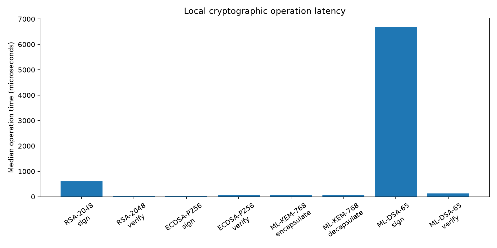
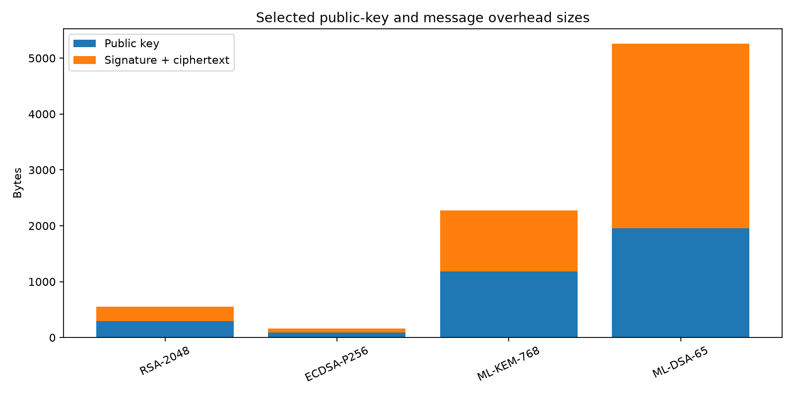
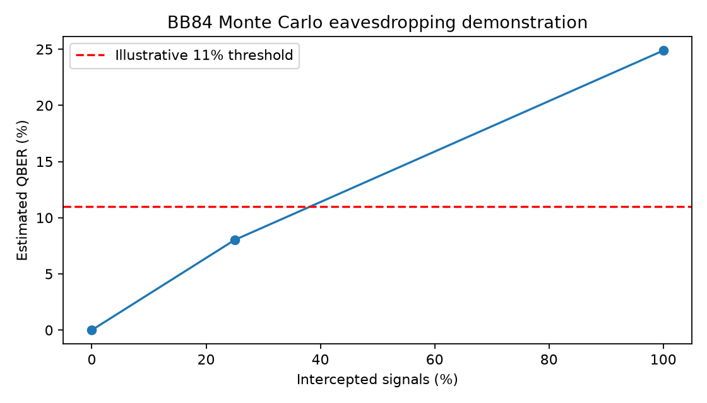

# Quantum-Safe Security for Smart Grids

A software testbed that compares classical, post-quantum, hybrid and quantum
security mechanisms on simulated smart-grid communication, and uses the
measurements to recommend which protection fits which part of the grid.

Course project for **INSE 6640 – Smart Grids and Control System Security**,
Concordia University, Fall 2026 (Group 6).

---

## Summary

Power grids depend on public-key cryptography (RSA, elliptic curves) to set up
keys, authenticate devices and sign firmware. A large enough quantum computer
running Shor's algorithm would break all of it, and attackers can already record
traffic today and decrypt it later. Grid equipment also stays in the field for
decades, so migration has to start well before quantum computers arrive.

The replacements each have a cost. Post-quantum algorithms have larger keys and
signatures, quantum key distribution needs dedicated fiber, and substation
protection messages (IEC 61850 GOOSE) must arrive within about **3 ms** in a
single Ethernet frame.

This project measures those costs instead of guessing them. It answers three
research questions:

1. **Where** is grid cryptography exposed to quantum attacks?
2. **Do** the quantum-safe options fit the grid's timing, size and hardware limits?
3. **Which** option should each part of the grid use, and how should a utility migrate?

### What I implemented

- **Smart-grid simulation**: control center, substation, smart meter and RTU
  nodes; WAN, GOOSE and AMI links; JSON grid messages; and a replay guard
  that rejects duplicate message IDs.
- **Classical security**: X25519 key exchange, RSA-2048 and ECDSA P-256
  signatures, AES-256-GCM and HMAC-SHA256.
- **Post-quantum security (NIST standards)**: ML-KEM-768 (FIPS 203) key
  encapsulation and ML-DSA-65 (FIPS 204) signatures.
- **Hybrid key exchange**: X25519 and ML-KEM-768 secrets combined with HKDF and
  bound to the handshake transcript. The session key stays safe if either part
  holds.
- **BB84 quantum key distribution**: a Monte Carlo simulation with sifting, QBER
  sampling, an 11% abort threshold and an intercept-resend eavesdropper.
- **Quantum random numbers**: a Qiskit Aer circuit (Hadamard and measure).
- **Benchmark suite**: median and p95 timings, encoded sizes, and a 3 ms budget
  check over 500 protected-message trials.
- **Attack tests**: tampered ciphertext, an altered signed message and a replayed
  command.
- **Interactive Streamlit dashboard** and a **step-by-step terminal demo**.
- **Research write-up**: literature review, threat model, recommendation matrix
  and final report.

---

## Key results

Measured on Apple Silicon (arm64), Python 3.12, 25 samples per operation, 256-byte
payload. Full data is in [`results/`](results/).

| Operation | Median | Size |
|---|---:|---:|
| AES-256-GCM encrypt | 3.4 µs | +28 B per message |
| HMAC-SHA256 | 3.0 µs | 32 B tag |
| ECDSA P-256 sign | 24 µs | 70 B signature |
| ML-KEM-768 encapsulate | 54 µs | 1,184 B public key, 1,088 B ciphertext |
| X25519 key agreement (both sides) | 87 µs | 32 B public key |
| Hybrid X25519 + ML-KEM-768 setup | 312 µs | – |
| RSA-2048 sign | 599 µs | 256 B signature |
| **ML-DSA-65 sign** | **6,704 µs** | **3,309 B signature** |

- **Post-quantum key exchange is fast.** ML-KEM costs about as much as classical
  key exchange.
- **Post-quantum signatures don't fit every message.** ML-DSA-65 signing takes
  6.7 ms, more than twice the 3 ms budget, and its 3,309-byte signature is larger
  than one Ethernet frame (about 1,500 B).
- **Symmetric protection per message fits easily.** The full protected message
  path took a median of 20.6 µs (p95 22.1 µs). That is 0.7% of the budget, and
  500 of 500 trials met the deadline.
- **BB84 detects a full eavesdropper.** QBER is 0% with no attack and 24.9% at
  100% interception, well above the 11% threshold. Partial interception (≤30%)
  can stay under the threshold, which is why real QKD needs privacy amplification.
- **All three attack tests were rejected.**

| Timing | Message size | BB84 error rate |
|---|---|---|
|  |  |  |

### Recommendation

| Grid area | Best fit |
|---|---|
| Control center ↔ WAN | Post-quantum / hybrid TLS and certificates |
| Substation backhaul | PQC for key setup and device identity |
| Substation GOOSE | Fast symmetric MAC per message, keys set up with PQC |
| Smart meters and RTUs | PQC for firmware signing and onboarding |
| QKD | Only on dedicated fiber links |
| QRNG | Optional key-generation add-on |

**In short:** make the setup quantum-safe, keep each message symmetric, and treat
QKD and QRNG as extras for special cases. The suggested migration path is
inventory → prioritize → crypto-agility → pilot → validate → migrate, aiming at
2031 for high-priority systems and 2035 to retire RSA and ECC.

---

## Getting started

Requires **Python 3.12+**.

```bash
git clone <this-repo-url>
cd quantum-smart-grid-security
python3 -m venv .venv
.venv/bin/python -m pip install --upgrade pip
.venv/bin/python -m pip install -r requirements-dev.txt
```

### Run the tests

```bash
.venv/bin/python -m pytest
```

### Run the step-by-step demo

Walks through a hybrid key setup, encrypting a "trip breaker" command, tamper
and replay attacks, the ML-DSA size and timing problem, and BB84 eavesdropper
detection. Press Enter to move between steps.

```bash
.venv/bin/python -m experiments.live_demo
```

### Open the dashboard

```bash
.venv/bin/streamlit run dashboard/app.py
```

The dashboard has four tabs: the grid message demo, benchmarks, an interactive
BB84 eavesdropper slider with the QRNG demo, and method and limits.

### Regenerate all results

```bash
.venv/bin/python -m experiments.run_benchmarks --iterations 25 --timing-trials 500
```

This writes CSV files, figures and `metadata.json` (hardware and library
versions) to `results/`. Use `--output <folder>` to keep the existing results.

---

## Project structure

```text
smart_grid/    Grid nodes, links, messages, network and replay protection
security/      Classical, post-quantum, hybrid, BB84 and QRNG implementations
experiments/   Benchmarks, attack tests, results CLI and live demo
dashboard/     Streamlit dashboard
tests/         Automated tests (pytest)
research/      Literature review, threat model and recommendation matrix
report/        Final project report
results/       Measured data (CSV), figures and run metadata
```

---

## Limitations

- All timings come from one laptop, not field devices or a real network.
- This is not an IEC 61850 or IEC 62351 implementation. The 3 ms figure is a
  comparison target, not a conformance test.
- The `pqcrypto` library implements the NIST algorithms but is not
  FIPS-validated.
- The hybrid combiner is for experimentation, not a standard protocol.
- BB84 and QRNG are simulations, not physical quantum hardware.
- Quantum machine learning is covered only in the literature review.

## Future work

- Run the benchmarks on real smart meters, RTUs and IEDs.
- Emulate a GOOSE network (for example libiec61850 with Mininet) to measure
  network delay and frame size.
- Use standard hybrid TLS and post-quantum certificates, and test smaller
  signatures such as FN-DSA (Falcon) and SLH-DSA.
- Test QKD on real fiber, and compare quantum ML with classical intrusion
  detection.

## References

The main sources are NIST FIPS 203 and 204, NIST IR 8547 (transition to PQC),
IEC 62351, Bennett and Brassard (1984) for BB84, and NIST SP 800-90A/B for
randomness. The full list is in
[`report/final_report.md`](report/final_report.md) and
[`research/literature_review.md`](research/literature_review.md).

## Author

**Pritesh Lathia**, Concordia University
